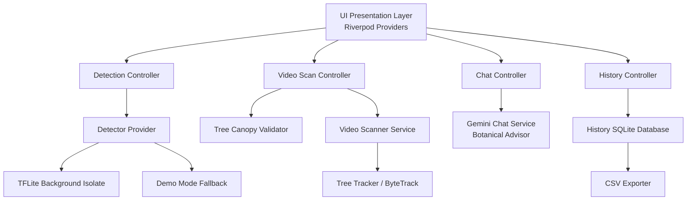

# MangoCount (Phase 1)

MangoCount is a capstone-grade Flutter application for detecting and counting mangoes (ripe and unripe) directly on-device using a YOLOv8/YOLO11 TFLite model.

## Overview
The app allows users to capture photos or pick from the gallery, runs inference in a background isolate to prevent UI freezing, and provides a fully interactive result screen with counting, confidence filtering, and manual correction.

## Key Features

- **Farmer-Friendly Design**: Clean, high-contrast white and emerald green interface designed specifically for field conditions and orchard workers, with simple, jargon-free terminology.
- **Single-Photo Mango Counter**: High-accuracy on-device detection of ripe and unripe mangoes with confidence calibration and manual touch corrections (add/remove counts).
- **Whole-Tree Video Scanning**: Walk around or pan across an entire tree. Frame sampling with ByteTrack-style tracking, Kalman filtering, and spatial trajectory matching prevents double-counting fruit across frames.
- **Pre-Scan Tree Canopy Validation**: Verifies that the recorded footage contains a real mango tree or canopy before running heavy frame processing, saving battery and time in the field.
- **Gemini AI Orchard Advisor**: Integrated agricultural chatbot providing agronomy guidance, harvest readiness analysis, and pest management tailored strictly to mango farming.
- **Offline-First Storage & CSV Export**: All scan results and counts are stored locally in SQLite (`sqflite`), allowing export to CSV for harvest records without internet.

## Architecture Diagram



## Setup & Running
1. Clone the repository:
   ```bash
   git clone https://github.com/rookiee-coder/mangocounter.git
   ```
2. Ensure you have Flutter installed (stable channel, Dart 3.5+).
3. Install dependencies:
   ```bash
   flutter pub get
   ```
4. Run on a physical device:
   ```bash
   flutter run --release
   ```

## Model & Labels
The app utilizes an on-device TFLite model:
- Model path: `assets/models/mango_yolo.tflite`
- Labels path: `assets/models/labels.txt`

If a model file is not present, the app automatically runs in **Demo Mode**, generating mock fruit detections so all UI features, counting, and history can still be tested and demonstrated.

## Model Training & Export
To train and export a model using Ultralytics YOLOv8 / YOLO11:
```python
from ultralytics import YOLO
model = YOLO('yolo11n.pt')
# Train on your mango dataset (2 classes: ripe, unripe)
model.train(data='mango.yaml', epochs=50, imgsz=640)
# Export to TFLite
model.export(format='tflite', imgsz=640)
```
Rename the exported model to `mango_yolo.tflite` and place it in `assets/models/`.

## Running Tests & Quality Checks
Run static analysis:
```bash
dart analyze lib
```
Run the automated test suite (56 unit and widget tests):
```bash
flutter test
```
